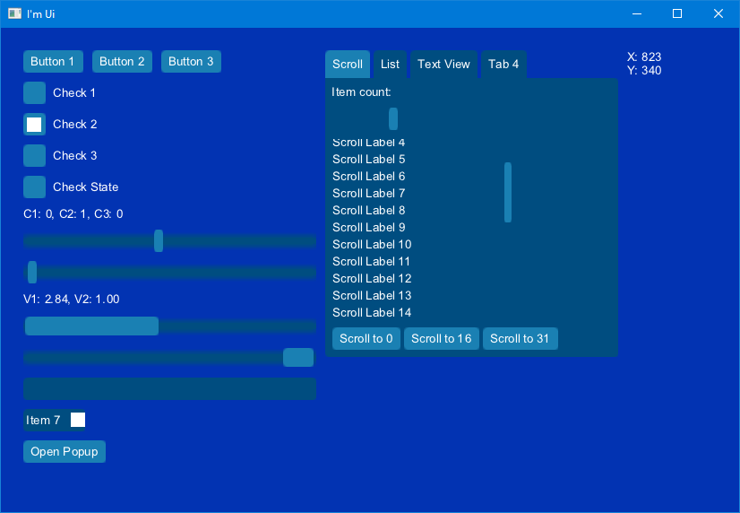

# I'm UI

[](https://github.com/IreNox/imui/actions/workflows/build.yml)

I'm UI is an immediate mode graphical user interface library written in C, with a C++ wrapper.
It is designed for embedding into applications, tools, and engines that provide their own windows,
input handling, and rendering.

## Features

- Five different layout methods(Stack, Scroll, Horizintal, Vertical, Grid)
- Toolbox with a lot of generic widgets like: Button, Check Box, List etc
- Customizable colors, skins, and widget styling
- Bitmap/SDF font generation
- C++ API wrapper included
- a lot more

## Sample



## Example

```c++
void doUi( ImuiContext* imui, float time )
{
	ImuiInput* input = imuiInputBegin( imui, NULL );
	// write input state
	const ImuiInputState* inputState = imuiInputEnd( imui );

	ImuiFrame* frame = imuiBegin( imui, time );
	ImuiSurface* surface = imuiSurfaceBegin( frame, "main", imuiSizeCreate( (float)windowWidth, (float)windowHeight ), inputState, 1.0f );
	ImuiWindow* window = imuiWindowBegin( surface, "main", imuiRectCreateSize( 0.0f, 0.0f, imuiSurfaceGetSize( surface ) ), 1 );

	ImuiWidget* buttonsLayout = imuiWidgetBeginNamed( window, "buttons" );
	imuiWidgetSetLayoutHorizontalSpacing( buttonsLayout, 10.0f );

	if( imuiToolboxButtonLabel( window, "Button 1" ) )
	{
		// do stuff
	}

	if( imuiToolboxButtonLabel( window, "Button 2" ) )
	{
		// do stuff
	}

	if( imuiToolboxButtonLabel( window, "Button 3" ) )
	{
		// do stuff
	}

	imuiWidgetEnd( buttonsLayout );

	imuiWindowEnd( window );
	imuiSurfaceEnd( surface );
	imuiEnd( frame );
}
```

## Import into you Project

Just import all files in `include` and `src` into your project and add `include` as include directory.

## Interactive Samples

The samples can be found in the `samples` sub directory. To build it with cmake run `cmake -B build` or tiki_build use the provided batch files to generate Visual Studio files.

There 6 different modes you can seletect by pressing 1-6:
1. Basic dynamic layouting
2. Complex static layouting
3. Input
4. Toolbox C
5. Toolbox C++
6. Multiline Text

## Tests

Unit test can be found in `tests` sub directory and built via CMake.

> **Disclaimer**
> Most of the the tests are written by AI. Don't trust them.

## AI usage

The library it self contains no vipe coded source code. For CMake configuration and unit tests AI has been used.

## Used Libraries

- [stb_truetype](https://github.com/nothings/stb)
- [tiki_build](https://github.com/IreNox/tiki_build)
